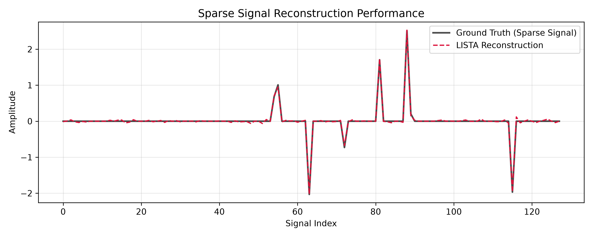
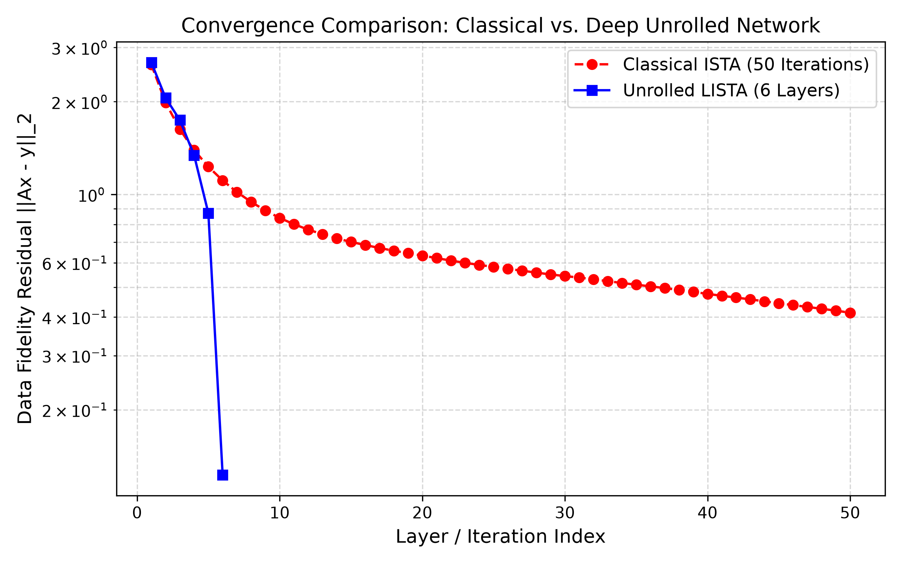

# Deep Unrolled Imaging: Learned Sparse Signal Reconstruction with ISTA and LISTA

## Abstract

Inverse problems arise when the quantity of interest cannot be observed directly and must instead be recovered from indirect, incomplete, or noisy measurements. They occur throughout computational imaging, medical imaging, radio astronomy, signal processing, microscopy, remote sensing, and many other scientific fields.

This project presents a simplified computational framework for studying inverse reconstruction using both **classical iterative optimization** and **deep unrolled learning**. A sparse ground-truth signal is first generated and passed through a known linear measurement operator to produce a lower-dimensional noisy observation. Because the number of measurements is smaller than the number of unknown signal values, direct inversion is not generally possible. Reconstruction therefore requires prior information about the structure of the unknown signal.

The project assumes that the underlying signal is sparse and formulates reconstruction as an L1-regularized inverse problem. Two reconstruction approaches are investigated. The first is the classical **Iterative Shrinkage-Thresholding Algorithm (ISTA)**, which repeatedly applies a gradient-descent step followed by soft-thresholding. The second is the **Learned Iterative Shrinkage-Thresholding Algorithm (LISTA)**, which converts a fixed number of ISTA-like iterations into layers of a trainable neural network. LISTA is initialized using the known measurement physics and subsequently learns its transformation matrices and threshold parameters from synthetic training data.

In the current experiment, the unknown signal has dimension 128 while only 64 measurements are available. Each training signal contains 8 nonzero coefficients, and 500 synthetic sparse signals are used for training. The LISTA network contains 6 unrolled layers and is trained for 100 epochs using the Adam optimizer and mean squared error loss.

A critical implementation issue involving the soft-threshold initialization was identified during development. Directly initializing the trainable threshold to `0.05` and subsequently applying the softplus function produced an effective threshold of approximately `0.718`, causing most reconstructed coefficients to collapse to zero. The initialization was corrected using the inverse softplus transformation and the classical ISTA threshold scale.

After correction, the LISTA training loss decreased from **0.027029 at epoch 1 to 0.001081 at epoch 100**. For the demonstrated reconstruction example, the 6-layer LISTA network closely recovered the locations and amplitudes of the sparse ground-truth coefficients and produced a substantially lower measurement residual than the 50-iteration classical ISTA baseline. An optimization supervisor additionally monitors reconstruction behaviour and reports whether the observed residual trajectory is converging or stagnating.

The project demonstrates the central principle of deep unfolding: **the mathematical structure of a known optimization algorithm can be embedded into a neural network and its parameters learned from data, combining model-based reconstruction with data-driven learning.**

---

# 1. Research Question

The central question explored by this project is:

> **Can a deep unrolled LISTA network learn to reconstruct sparse signals from incomplete and noisy linear measurements using substantially fewer layers than the number of iterations required by classical ISTA?**

The project also investigates several related questions:

- How does classical ISTA reconstruct a sparse signal from an underdetermined measurement system?
- How can ISTA iterations be transformed into trainable neural-network layers?
- Can physical knowledge of the measurement operator be used to initialize a neural network?
- How does the measurement residual evolve through classical iterations and learned layers?
- Can a diagnostic supervisor automatically identify stagnating or converging reconstruction behaviour?

---

# 2. Why This Problem Matters

Many scientific instruments do not directly observe the object that researchers ultimately want to study.

Instead, an instrument produces measurements related to the unknown object through some physical transformation.

Examples include:

- MRI measurements acquired in frequency space;
- CT projection measurements;
- radio-interferometric visibility measurements;
- blurred astronomical observations;
- compressed sensing systems;
- seismic measurements;
- microscopy measurements;
- radar and remote-sensing observations.

The general problem can be represented as

```math
\mathbf{y} = \mathbf{A}\mathbf{x} + \mathbf{n}
```

where:

- $\mathbf{x}$ is the unknown signal or image;
- $\mathbf{A}$ is the forward measurement operator;
- $\mathbf{y}$ contains the observed measurements;
- $\mathbf{n}$ represents measurement noise.

The objective is not to predict $\mathbf{y}$ from $\mathbf{x}$. The difficult problem is the reverse:

```math
\mathbf{y} \longrightarrow \mathbf{x}
```

This is an **inverse problem**.

---

# 3. Why Reconstruction Is Necessary

Suppose the unknown signal contains 128 values:

```math
\mathbf{x} \in \mathbb{R}^{128}
```

but the measuring system produces only 64 observations:

```math
\mathbf{y} \in \mathbb{R}^{64}
```

The measurement matrix therefore has dimensions

```math
\mathbf{A} \in \mathbb{R}^{64 \times 128}
```

and the measurement model becomes

```math
\mathbf{y} = \mathbf{A}\mathbf{x} + \mathbf{n}
```

There are 128 unknown signal values but only 64 measurements.

Therefore,

```math
m < n
```

where:

```math
m = 64
```

and

```math
n = 128
```

This makes the system **underdetermined**.

There may be many different candidate signals capable of producing similar measurements.

Additional information about the expected structure of the signal is therefore required.

---

# 4. Sparse Signal Prior

This project assumes that the unknown signal is **sparse**.

A sparse signal contains mostly zeros and only a small number of nonzero coefficients.

The signal dimension is

```math
n = 128
```

while the number of nonzero coefficients is

```math
s = 8
```

Therefore, only 8 of the 128 signal positions contain meaningful nonzero values.

A sparse signal can be written conceptually as

```math
\mathbf{x} =
[x_1,x_2,\ldots,x_{128}]^T
```

subject to

```math
\|\mathbf{x}\|_0 = 8
```

where $\|\mathbf{x}\|_0$ represents the number of nonzero elements.

The L0 quantity is useful for describing sparsity, but directly optimizing it is generally difficult because it produces a combinatorial optimization problem.

A common alternative is the L1 norm.

---

# 5. The L1 Norm

The L1 norm of a signal is

```math
\|\mathbf{x}\|_1
=
\sum_{i=1}^{n}|x_i|
```

Unlike the L2 norm, the L1 norm encourages many coefficients to become exactly zero.

This makes it particularly useful for sparse reconstruction.

The reconstruction problem can therefore be formulated as

```math
\hat{\mathbf{x}}
=
\underset{\mathbf{x}}{\mathrm{argmin}}
\left[
\frac{1}{2}
\|\mathbf{A}\mathbf{x}-\mathbf{y}\|_2^2
+
\lambda\|\mathbf{x}\|_1
\right]
```

This is the central optimization problem behind both ISTA and LISTA in this project.

---

# 6. Understanding the Objective Function

The objective contains two competing terms.

## 6.1 Data-Fidelity Term

The first term is

```math
\frac{1}{2}
\|\mathbf{A}\mathbf{x}-\mathbf{y}\|_2^2
```

For a candidate reconstruction $\mathbf{x}$, the forward model predicts measurements

```math
\hat{\mathbf{y}} = \mathbf{A}\mathbf{x}
```

The difference between the predicted and actual measurements is

```math
\mathbf{r}
=
\mathbf{A}\mathbf{x}-\mathbf{y}
```

where $\mathbf{r}$ is the **measurement residual**.

The Euclidean residual norm is

```math
\|\mathbf{r}\|_2
=
\|\mathbf{A}\mathbf{x}-\mathbf{y}\|_2
```

and the squared data-fidelity term penalizes reconstructions that do not explain the observed measurements.

A smaller value means that the reconstructed signal is more consistent with the measurements.

---

## 6.2 Sparsity Regularization

The second term is

```math
\lambda\|\mathbf{x}\|_1
```

where $\lambda$ controls the strength of the sparsity penalty.

A larger $\lambda$ encourages more coefficients toward zero.

A smaller $\lambda$ places greater emphasis on matching the measurements.

The complete objective therefore balances two requirements:

```text
Explain the measurements
        +
Prefer a sparse solution
```

This is an example of **regularization**.

---

# 7. The Forward Measurement Operator

The measurement system is represented by the matrix

```math
\mathbf{A}
\in
\mathbb{R}^{64\times128}
```

In the current simplified experiment, the matrix is randomly generated.

The forward operation is

```math
\mathbf{y}
=
\mathbf{A}\mathbf{x}
```

before noise is added.

In the Python implementation, a batch of row-vector signals is multiplied by the transpose of the stored matrix:

```python
y = x @ A.T
```

This is equivalent to applying the mathematical forward model to every signal in the batch.

---

# 8. Why the Forward Operator Is Important

The forward operator represents the **measurement physics**.

In this demonstration, $\mathbf{A}$ is a random linear matrix.

In a real imaging problem, $\mathbf{A}$ could instead represent:

- Fourier sampling;
- tomographic projection;
- image blurring;
- coil sensitivity;
- subsampling;
- sensor response;
- radio-interferometric measurement;
- another physically defined acquisition process.

This separation is important because the reconstruction algorithm should understand how an unknown signal produces measurements.

---

# 9. The Adjoint Operator

The code also implements the adjoint operation.

If the forward operator is

```math
\mathbf{A}
```

then, for a real-valued matrix, its adjoint is represented by

```math
\mathbf{A}^T
```

The adjoint maps information from measurement space back toward signal space.

The code performs this operation using the equivalent row-vector form:

```python
y @ A
```

The adjoint is important because gradient-based inverse reconstruction repeatedly needs to propagate measurement errors back into the signal domain.

---

# 10. Measurement Noise

Real measurements are rarely perfect.

The project therefore uses

```math
\mathbf{y}
=
\mathbf{A}\mathbf{x}
+
\mathbf{n}
```

where $\mathbf{n}$ represents additive noise.

Noise makes reconstruction more difficult because the algorithm should recover the underlying signal without simply fitting every measurement disturbance.

The experiment uses a small Gaussian noise level to create a more realistic inverse problem than completely noiseless measurements.

---

# 11. Spectral Norm and Lipschitz Constant

ISTA requires an appropriate step size.

For the least-squares data term

```math
f(\mathbf{x})
=
\frac{1}{2}
\|\mathbf{A}\mathbf{x}-\mathbf{y}\|_2^2
```

the gradient is

```math
\nabla f(\mathbf{x})
=
\mathbf{A}^T
(\mathbf{A}\mathbf{x}-\mathbf{y})
```

The Lipschitz constant of this gradient is

```math
L
=
\|\mathbf{A}\|_2^2
```

where $\|\mathbf{A}\|_2$ is the spectral norm of the matrix.

The project obtained approximately

```math
L = 5.5195
```

for the demonstrated experiment.

---

# 12. Power Iteration

The operator class contains a power-iteration procedure for estimating the largest eigenvalue associated with

```math
\mathbf{A}^T\mathbf{A}
```

Starting from a vector $\mathbf{v}$, power iteration repeatedly applies

```math
\mathbf{v}_{k+1}
=
\frac{
\mathbf{A}^T\mathbf{A}\mathbf{v}_k
}{
\|\mathbf{A}^T\mathbf{A}\mathbf{v}_k\|_2
}
```

The iterations increasingly align $\mathbf{v}$ with the dominant eigenvector.

Because

```math
\lambda_{\max}
(\mathbf{A}^T\mathbf{A})
=
\|\mathbf{A}\|_2^2
```

the process provides an estimate of the Lipschitz constant required by ISTA.

---

# 13. ISTA: Classical Reconstruction

The first reconstruction algorithm is the **Iterative Shrinkage-Thresholding Algorithm (ISTA)**.

ISTA solves problems of the form

```math
\underset{\mathbf{x}}{\mathrm{minimize}}
\quad
\frac{1}{2}
\|\mathbf{A}\mathbf{x}-\mathbf{y}\|_2^2
+
\lambda\|\mathbf{x}\|_1
```

by alternating between:

1. a gradient step;
2. a soft-thresholding step.

---

# 14. ISTA Gradient Step

The gradient of the data-fidelity term is

```math
\nabla f(\mathbf{x}_k)
=
\mathbf{A}^T
(\mathbf{A}\mathbf{x}_k-\mathbf{y})
```

ISTA performs

```math
\mathbf{z}_k
=
\mathbf{x}_k
-
\eta
\mathbf{A}^T
(\mathbf{A}\mathbf{x}_k-\mathbf{y})
```

where $\eta$ is the step size.

The project uses

```math
\eta
=
\frac{1}{L}
```

with

```math
L
=
\|\mathbf{A}\|_2^2
```

Therefore,

```math
\eta
=
\frac{1}
{\|\mathbf{A}\|_2^2}
```

The gradient step attempts to make the current signal estimate explain the measurements more accurately.

---

# 15. Soft-Thresholding

After the gradient step, ISTA applies soft-thresholding.

For a scalar $z$, soft-thresholding is

```math
S_{\theta}(z)
=
\mathrm{sign}(z)
\max(|z|-\theta,0)
```

where $\theta$ is the threshold.

For ISTA,

```math
\theta
=
\eta\lambda
```

and therefore

```math
\theta
=
\frac{\lambda}{L}
```

The operation has three important behaviours.

If

```math
|z| < \theta
```

then

```math
S_{\theta}(z)=0
```

If $z$ is sufficiently positive,

```math
S_{\theta}(z)=z-\theta
```

and if $z$ is sufficiently negative,

```math
S_{\theta}(z)=z+\theta
```

Small coefficients are therefore eliminated while sufficiently large coefficients survive with reduced magnitude.

This is what creates sparse solutions.

---

# 16. Complete ISTA Update

Combining the gradient and thresholding operations gives

```math
\mathbf{x}_{k+1}
=
S_{\eta\lambda}
\left[
\mathbf{x}_k
-
\eta
\mathbf{A}^T
(\mathbf{A}\mathbf{x}_k-\mathbf{y})
\right]
```

This is the mathematical basis of the `classical_ista()` implementation.

The experiment performs

```text
50 ISTA iterations
```

for the classical baseline.

---

# 17. Why Classical ISTA Is Important

ISTA is important because it provides a transparent, mathematically motivated baseline.

Every iteration has a clear interpretation:

```text
Current estimate
      ↓
Forward measurement prediction
      ↓
Measurement error
      ↓
Back-projection through Aᵀ
      ↓
Gradient correction
      ↓
Soft thresholding
      ↓
New sparse estimate
```

ISTA does not require training data.

Its behaviour is determined by the measurement operator, regularization strength, and optimization procedure.

This makes it useful as a reference against which a learned reconstruction network can be compared.

---

# 18. From ISTA to LISTA

The key idea behind this project is that an ISTA iteration can be rewritten into a form resembling a neural-network layer.

Starting from

```math
\mathbf{x}_{k+1}
=
S_{\eta\lambda}
\left[
\mathbf{x}_k
-
\eta
\mathbf{A}^T
(\mathbf{A}\mathbf{x}_k-\mathbf{y})
\right]
```

expand the expression inside the threshold:

```math
\mathbf{x}_{k+1}
=
S_{\eta\lambda}
\left[
\mathbf{x}_k
-
\eta\mathbf{A}^T\mathbf{A}\mathbf{x}_k
+
\eta\mathbf{A}^T\mathbf{y}
\right]
```

Group the terms involving $\mathbf{x}_k$:

```math
\mathbf{x}_{k+1}
=
S_{\eta\lambda}
\left[
(\mathbf{I}-\eta\mathbf{A}^T\mathbf{A})
\mathbf{x}_k
+
\eta\mathbf{A}^T\mathbf{y}
\right]
```

Define

```math
\mathbf{W}_1
=
\mathbf{I}
-
\eta\mathbf{A}^T\mathbf{A}
```

and

```math
\mathbf{W}_2
=
\eta\mathbf{A}^T
```

Then ISTA becomes

```math
\mathbf{x}_{k+1}
=
S_{\theta}
\left[
\mathbf{W}_1\mathbf{x}_k
+
\mathbf{W}_2\mathbf{y}
\right]
```

This equation looks very similar to a neural-network layer.

That observation motivates LISTA.

---

# 19. LISTA: Learned ISTA

LISTA stands for **Learned Iterative Shrinkage-Thresholding Algorithm**.

Instead of repeatedly applying fixed matrices determined entirely by $\mathbf{A}$, LISTA allows the matrices and thresholds to become trainable parameters.

A LISTA layer can be written as

```math
\mathbf{x}_{k+1}
=
S_{\theta_k}
\left[
\mathbf{W}_{1,k}\mathbf{x}_k
+
\mathbf{W}_{2,k}\mathbf{y}
\right]
```

where:

- $\mathbf{W}_{1,k}$ is a learned recurrent transformation;
- $\mathbf{W}_{2,k}$ maps the measurements into signal space;
- $\theta_k$ is the learned threshold for layer $k$;
- $\mathbf{x}_k$ is the current reconstruction;
- $\mathbf{y}$ contains the measurements.

Each LISTA layer corresponds conceptually to one learned optimization step.

---

# 20. Deep Unrolling

The process of converting iterations of an optimization algorithm into layers of a neural network is known as **deep unfolding** or **algorithm unrolling**.

Instead of

```text
ISTA iteration 1
ISTA iteration 2
ISTA iteration 3
...
ISTA iteration 50
```

the project constructs

```text
LISTA layer 1
LISTA layer 2
LISTA layer 3
LISTA layer 4
LISTA layer 5
LISTA layer 6
```

Each layer retains the mathematical structure of ISTA but contains parameters that can be optimized from data.

This provides a connection between classical optimization and deep learning.

---

# 21. Physics-Informed Initialization

The LISTA network is not initialized with completely arbitrary transformations.

Its initial weights are derived directly from ISTA.

Using

```math
\eta
=
\frac{1}{L}
```

the first matrix is initialized as

```math
\mathbf{W}_1^{(0)}
=
\mathbf{I}
-
\frac{1}{L}
\mathbf{A}^T\mathbf{A}
```

and the second matrix as

```math
\mathbf{W}_2^{(0)}
=
\frac{1}{L}
\mathbf{A}^T
```

These are exactly the matrices obtained by rearranging the classical ISTA update.

The neural network therefore begins from a known optimization procedure rather than from an arbitrary mapping.

Training then modifies these matrices to improve reconstruction performance for the signal distribution represented in the training data.

---

# 22. Why Physics-Informed Initialization Matters

A completely generic neural network would need to learn the measurement-to-signal relationship largely from data.

LISTA begins with knowledge of the inverse problem.

The initialization already contains information about:

```math
\mathbf{A}
```

```math
\mathbf{A}^T
```

```math
\mathbf{A}^T\mathbf{A}
```

and

```math
L=\|\mathbf{A}\|_2^2
```

This produces an important design philosophy:

> **Do not ask the neural network to rediscover mathematical structure that is already known.**

Instead, known structure can be embedded into the network and data-driven learning can refine it.

---

# 23. The Threshold Initialization Problem

An important implementation issue was discovered during development.

The original threshold parameter was initialized using

```python
self.threshold = nn.Parameter(torch.tensor([0.05]))
```

but the forward pass enforced positivity using

```python
F.softplus(self.threshold)
```

The softplus function is

```math
\mathrm{softplus}(z)
=
\ln(1+e^z)
```

Therefore,

```math
\mathrm{softplus}(0.05)
\approx
0.718
```

The effective threshold was therefore not `0.05`.

It was approximately

```math
0.718
```

This threshold was sufficiently large to suppress most coefficients produced by the LISTA layers.

The result was an almost completely zero reconstruction.

---

# 24. Correct Threshold Initialization

The corrected implementation specifies the desired **effective threshold** and transforms it through the inverse softplus function before storing it as the trainable parameter.

If

```math
\theta
=
\mathrm{softplus}(z)
```

then the inverse relationship is

```math
z
=
\ln(e^\theta-1)
```

The code therefore uses the equivalent PyTorch expression:

```python
raw_init = torch.log(
    torch.expm1(torch.tensor(float(init_thresh)))
)
```

and later computes

```python
threshold = F.softplus(self.threshold)
```

Consequently,

```math
\mathrm{softplus}
(
\mathrm{inverseSoftplus}(\theta)
)
=
\theta
```

up to numerical precision.

---

# 25. Matching LISTA and ISTA Threshold Scales

The corrected LISTA initialization also uses the classical ISTA threshold scale.

ISTA uses

```math
\theta
=
\eta\lambda
```

Since

```math
\eta=\frac{1}{L}
```

the threshold becomes

```math
\theta
=
\frac{\lambda}{L}
```

For the demonstrated experiment,

```math
L=5.5195
```

and

```math
\lambda=0.1
```

giving approximately

```math
\theta
=
\frac{0.1}{5.5195}
\approx
0.0181
```

Therefore, LISTA begins with an effective threshold of approximately `0.0181` rather than the previous effective threshold of approximately `0.718`.

This correction produced a major improvement in reconstruction behaviour.

---

# 26. LISTA Architecture

The network contains

```text
6 unrolled layers
```

Each layer performs

```math
\mathbf{z}_k
=
\mathbf{W}_{1,k}\mathbf{x}_k
+
\mathbf{W}_{2,k}\mathbf{y}
```

followed by

```math
\mathbf{x}_{k+1}
=
S_{\theta_k}(\mathbf{z}_k)
```

The complete network can therefore be represented as

```text
Measurements y
      │
      ▼
LISTA Layer 1
      │
      ▼
LISTA Layer 2
      │
      ▼
LISTA Layer 3
      │
      ▼
LISTA Layer 4
      │
      ▼
LISTA Layer 5
      │
      ▼
LISTA Layer 6
      │
      ▼
Reconstruction x̂
```

The intermediate reconstruction after every layer is stored.

This makes it possible to study how the reconstruction evolves through the network.

---

# 27. Why Intermediate Layers Are Important

A conventional neural network is often treated as a sequence of abstract transformations.

An unrolled network has a stronger connection to an optimization algorithm.

Each layer represents an approximate reconstruction step.

Therefore, the trajectory

```math
\mathbf{x}_0,
\mathbf{x}_1,
\mathbf{x}_2,
\ldots,
\mathbf{x}_6
```

can be examined.

For each intermediate reconstruction, the measurement residual can be calculated:

```math
r_k
=
\|\mathbf{A}\mathbf{x}_k-\mathbf{y}\|_2
```

This allows the network to be studied as an iterative reconstruction process rather than only as a black-box input-output function.

---

# 28. Synthetic Dataset

The current demonstration uses synthetic sparse signals.

The main experimental parameters are:

| Parameter | Value |
|---|---:|
| Signal dimension | 128 |
| Measurement dimension | 64 |
| Number of training signals | 500 |
| Nonzero coefficients per signal | 8 |
| LISTA layers | 6 |
| ISTA iterations | 50 |
| Regularization parameter | 0.1 |
| Training epochs | 100 |
| Optimizer | Adam |
| Learning rate | 0.001 |
| Training objective | Mean Squared Error |
| Measurement noise | Gaussian |
| Demonstrated Lipschitz constant | 5.5195 |

The sparse training signals provide known ground truth.

This is useful because reconstruction accuracy can be measured directly.

---

# 29. Why Ground Truth Is Important

In a reconstruction problem, it is necessary to distinguish between:

```text
Unknown signal
```

and

```text
Observed measurements
```

During synthetic experiments, the true signal is known because it was generated computationally.

This signal is the **ground truth**.

The measurement operator transforms the ground truth into observations:

```math
\mathbf{x}_{true}
\longrightarrow
\mathbf{A}\mathbf{x}_{true}
\longrightarrow
\mathbf{y}
```

The reconstruction algorithm receives $\mathbf{y}$ and attempts to reverse the process:

```math
\mathbf{y}
\longrightarrow
\hat{\mathbf{x}}
```

Because $\mathbf{x}_{true}$ is known, the estimate $\hat{\mathbf{x}}$ can be compared directly against it.

---

# 30. Training Objective

LISTA is trained using mean squared error between the predicted reconstruction and the known ground truth.

For a batch containing $B$ training examples, the loss is

```math
\mathcal{L}
=
\frac{1}{B}
\sum_{b=1}^{B}
\frac{1}{n}
\|
\hat{\mathbf{x}}^{(b)}
-
\mathbf{x}^{(b)}
\|_2^2
```

where:

- $\hat{\mathbf{x}}^{(b)}$ is the LISTA reconstruction;
- $\mathbf{x}^{(b)}$ is the ground-truth sparse signal;
- $n$ is the signal dimension;
- $B$ is the number of examples in the batch.

The optimizer modifies:

```math
\mathbf{W}_{1,k}
```

```math
\mathbf{W}_{2,k}
```

and

```math
\theta_k
```

to reduce this loss.

---

# 31. Training Results

After correcting the threshold initialization, the observed training loss was:

| Epoch | Training Loss |
|---:|---:|
| 1 | 0.027029 |
| 20 | 0.014279 |
| 40 | 0.008750 |
| 60 | 0.004512 |
| 80 | 0.002232 |
| 100 | 0.001081 |

The loss decreased consistently throughout training.

From epoch 1 to epoch 100, the loss decreased from

```math
0.027029
```

to

```math
0.001081
```

which represents a substantial reduction in reconstruction error on the training data.

---

# 32. Reconstruction Performance

The reconstruction plot compares:

- the original sparse ground-truth signal;
- the final six-layer LISTA reconstruction.



The corrected LISTA model recovers the principal positive and negative sparse coefficients and closely follows their amplitudes in the demonstrated example.

Small fluctuations remain around zero-valued regions, which can arise from noise and imperfect reconstruction.

The important result is that the network no longer collapses to an all-zero solution.

---

# 33. Why the LISTA Reconstruction Is Important

The reconstruction plot answers the most direct question:

> Did the network recover the underlying sparse signal?

A low measurement residual alone is not sufficient to answer this.

Because the measurement problem is underdetermined, two different signals may potentially explain the measurements reasonably well.

The reconstructed signal should therefore also be compared against the known ground truth.

The close agreement between the demonstrated LISTA reconstruction and ground truth shows that the trained network learned substantially more than simply returning zero.

---

# 34. Convergence Comparison

The project also compares the measurement residual of classical ISTA with the residual produced after each LISTA layer.



The residual is

```math
r_k
=
\|\mathbf{A}\mathbf{x}_k-\mathbf{y}\|_2
```

A smaller residual indicates that the current reconstruction produces measurements that more closely agree with the actual observation.

---

# 35. Classical ISTA Convergence

The classical ISTA curve decreases gradually over 50 iterations.

This behaviour reflects the iterative nature of the algorithm:

```text
Iteration 1
   ↓
Iteration 2
   ↓
Iteration 3
   ↓
...
   ↓
Iteration 50
```

Each iteration makes another mathematically prescribed correction.

For the demonstrated example, the residual eventually reaches approximately

```math
0.41
```

after 50 iterations.

---

# 36. LISTA Convergence

The six LISTA layers begin with behaviour related to ISTA because their parameters were initialized from the ISTA equations.

However, training modifies the layer parameters.

The learned network can therefore depart from the original fixed ISTA trajectory.

For the demonstrated example, the LISTA residual falls sharply by the sixth layer to approximately

```math
0.12
```

while classical ISTA remains higher even after 50 iterations.

This demonstrates the intended idea behind LISTA:

> A learned unrolled network may learn a reconstruction trajectory that reaches a useful solution in fewer sequential stages than the original fixed optimization algorithm.

However, this result should not yet be interpreted as universal evidence that LISTA is superior to ISTA. Performance must be evaluated on unseen test signals before making a general claim.

---

# 37. Measurement Residual vs Reconstruction Error

Two different concepts should not be confused.

## Measurement Residual

```math
\|\mathbf{A}\hat{\mathbf{x}}-\mathbf{y}\|_2
```

This measures how well the reconstructed signal explains the measurements.

## Reconstruction Error

```math
\|\hat{\mathbf{x}}-\mathbf{x}_{true}\|_2
```

This measures how close the reconstruction is to the actual ground truth.

A reconstruction can potentially have a small measurement residual while still differing from the true signal, especially in an underdetermined inverse problem.

Therefore, both quantities are useful.

---

# 38. Relative Reconstruction Error

A useful normalized metric is

```math
E_{rel}
=
\frac{
\|\hat{\mathbf{x}}-\mathbf{x}_{true}\|_2
}{
\|\mathbf{x}_{true}\|_2
}
```

This measures reconstruction error relative to the magnitude of the original signal.

A value closer to zero indicates better reconstruction.

Future evaluation of this project should report this metric across an independent test dataset.

---

# 39. Mean Squared Error

Another useful metric is

```math
\mathrm{MSE}
=
\frac{1}{n}
\sum_{i=1}^{n}
(\hat{x}_i-x_i)^2
```

MSE measures the average squared difference between the reconstructed and true signal coefficients.

Lower values indicate better reconstruction.

---

# 40. Support Recovery

Because the signals are sparse, another important question is whether the algorithm identifies the correct nonzero locations.

Define the true support as

```math
S
=
\{i:x_i\neq0\}
```

and the estimated support as

```math
\hat{S}
=
\{i:|\hat{x}_i|>\epsilon\}
```

for some small tolerance $\epsilon$.

Support recovery evaluates whether the reconstruction correctly identifies **where the important coefficients occur**, not only whether the overall numerical error is small.

---

# 41. Agentic Optimization Supervisor

The project includes an `AgenticOptimizationSupervisor`.

Its current role is diagnostic.

It examines the residual trajectory and classifies the observed optimization behaviour.

For the corrected experiment, the supervisor reported:

```text
Status: CONVERGING
Lipschitz Constant (L): 5.5195
Recommended Policy Action:
Descent condition satisfied. Monotonicity maintained.
```

The supervisor therefore provides a higher-level interpretation of the numerical optimization trajectory.

---

# 42. What the Supervisor Does

Conceptually, the supervisor receives information such as:

```text
Reconstruction trajectory
        +
Residual history
        +
Operator bound
```

and produces:

```text
Optimization status
        +
Recommended action
```

For example:

```text
STAGNATED
→ decrease threshold or consider adaptive momentum
```

or

```text
CONVERGING
→ descent condition satisfied
```

This creates an additional reasoning layer above the reconstruction algorithm.

---

# 43. What the Supervisor Does Not Yet Do

The current supervisor should not be interpreted as an autonomous optimizer.

At present, it **diagnoses** reconstruction behaviour and recommends an action.

It does not yet automatically modify the LISTA parameters, retrain the model, change the optimizer, or restart reconstruction.

A future extension could close this loop:

```text
Reconstruction
      ↓
Supervisor
      ↓
Detect problem
      ↓
Modify reconstruction policy
      ↓
Run reconstruction again
      ↓
Re-evaluate
```

Such a system would move from diagnostic supervision toward genuinely adaptive reconstruction.

---

# 44. Project Structure

```text
deep-unrolled-imaging/
│
├── src/
│   ├── __init__.py
│   ├── operators.py
│   ├── models.py
│   ├── agent.py
│   └── utils.py
│
├── run_demo.py
│
├── reconstruction.png
├── convergence_comparison.png
│
└── README.md
```

---

# 45. File Descriptions

## `src/operators.py`

Defines the physical measurement operator.

Responsibilities include:

- constructing the measurement matrix;
- applying the forward operator;
- applying the adjoint operator;
- estimating the spectral norm;
- providing the Lipschitz constant used by optimization.

Conceptually:

```text
Signal space
     │
     │ A
     ▼
Measurement space
```

and

```text
Measurement space
     │
     │ Aᵀ
     ▼
Signal space
```

---

## `src/models.py`

Contains the reconstruction algorithms.

It implements:

- soft-thresholding;
- the six-layer LISTA network;
- physics-informed LISTA initialization;
- corrected positive threshold parameterization;
- classical ISTA.

This file contains the main mathematical reconstruction logic of the project.

---

## `src/agent.py`

Contains the optimization supervisor.

It examines reconstruction behaviour and returns diagnostic information such as:

```text
CONVERGING
```

or

```text
STAGNATED
```

along with a recommended policy response.

---

## `src/utils.py`

Contains plotting utilities used to visualize:

- ground truth versus LISTA reconstruction;
- classical ISTA versus LISTA residual trajectories.

These plots provide interpretable evidence of reconstruction behaviour.

---

## `run_demo.py`

Runs the complete experiment.

The script performs the following sequence:

```text
1. Create measurement operator
             ↓
2. Generate sparse signals
             ↓
3. Produce noisy measurements
             ↓
4. Build LISTA network
             ↓
5. Train LISTA
             ↓
6. Run classical ISTA
             ↓
7. Run trained LISTA
             ↓
8. Compare convergence
             ↓
9. Plot reconstruction
             ↓
10. Invoke optimization supervisor
```

---

# 46. Installation

The project was tested using Python 3.12.

Create a virtual environment:

```bash
python3.12 -m venv .venv
```

Activate it on macOS or Linux:

```bash
source .venv/bin/activate
```

Upgrade pip:

```bash
python -m pip install --upgrade pip
```

Install the required packages:

```bash
python -m pip install torch matplotlib "numpy<2"
```

If required by the installed Matplotlib configuration:

```bash
python -m pip install "contourpy<1.4"
```

---

# 47. Running the Experiment

From the project root directory, run:

```bash
python run_demo.py
```

A successful execution should display output similar to:

```text
--- 1. Initializing Physical Imaging System ---
Operator bounds computed.
Spectral Norm (Lipschitz Constant L) = 5.5195

--- 2. Building & Training Unrolled LISTA Network ---
Epoch [1/100] | Loss: 0.027029
Epoch [20/100] | Loss: 0.014279
Epoch [40/100] | Loss: 0.008750
Epoch [60/100] | Loss: 0.004512
Epoch [80/100] | Loss: 0.002232
Epoch [100/100] | Loss: 0.001081

--- 3. Running Convergence & Layer Interpretability Analysis ---
Reconstruction plots saved to disk.

--- 4. Invoking Agentic Optimization Supervisor ---
Status: CONVERGING
Lipschitz Constant (L): 5.5195
Recommended Policy Action:
Descent condition satisfied. Monotonicity maintained.
```

---

# 48. Opening the Results

On macOS:

```bash
open reconstruction.png
```

and

```bash
open convergence_comparison.png
```

---

# 49. What the Experiment Demonstrates

The experiment demonstrates several concepts simultaneously.

### 1. Inverse reconstruction

The unknown signal must be recovered from indirect noisy measurements.

### 2. Underdetermined sensing

The project attempts to reconstruct 128 unknown signal values from only 64 measurements.

### 3. Regularization

Sparsity provides additional information that stabilizes reconstruction.

### 4. Classical optimization

ISTA solves the L1-regularized reconstruction problem through repeated gradient and thresholding operations.

### 5. Deep unfolding

ISTA iterations are transformed into neural-network layers.

### 6. Physics-informed learning

LISTA begins from parameters derived from the measurement operator.

### 7. Data-driven optimization

Training allows the unrolled parameters to move away from fixed ISTA values.

### 8. Interpretability

Intermediate LISTA layers can be examined as reconstruction stages.

### 9. Optimization monitoring

The supervisor analyzes whether the observed trajectory appears to be converging or stagnating.

---

# 50. Why Not Use a Completely Black-Box Neural Network?

A generic neural network could theoretically learn a mapping

```math
\mathbf{y}
\longrightarrow
\hat{\mathbf{x}}
```

without explicitly representing the reconstruction algorithm.

However, this would discard useful mathematical knowledge about the measurement process and sparse inverse problem.

LISTA instead embeds the structure

```math
\mathbf{A},
\mathbf{A}^T,
\mathbf{A}^T\mathbf{A},
L,
\lambda
```

into the initial network.

This creates a model whose architecture has a direct relationship to a known optimization algorithm.

The network is therefore not simply learning *what answer to produce*.

It is learning **how to improve a structured reconstruction procedure**.

---

# 51. Classical Optimization vs Deep Unrolling

| Property | Classical ISTA | Unrolled LISTA |
|---|---|---|
| Based on inverse-problem mathematics | Yes | Yes |
| Requires training | No | Yes |
| Uses soft-thresholding | Yes | Yes |
| Uses measurement operator | Yes | Yes |
| Parameters learned from data | No | Yes |
| Fixed update rule | Yes | No |
| Number used here | 50 iterations | 6 layers |
| Intermediate states interpretable | Yes | Yes |
| Can adapt to training distribution | No | Yes |

The purpose of LISTA is therefore not to abandon optimization.

It is to **learn parts of the optimization process itself**.

---

# 52. Current Experimental Result

The corrected implementation produced a visually accurate sparse reconstruction in the demonstrated example.

The six-layer LISTA network recovered the major ground-truth coefficients while maintaining relatively small errors in zero-valued regions.

Its demonstrated measurement residual also decreased substantially across the six learned layers and reached a lower value than the 50-iteration ISTA baseline for the displayed example.

This result illustrates the potential computational advantage of learned unrolling: a relatively shallow learned sequence can potentially approximate or improve upon a much longer classical optimization trajectory for signals drawn from the learned distribution.

---

# 53. Important Limitation

The current result is a **proof-of-concept experiment**, not evidence that LISTA universally outperforms ISTA.

The demonstrated reconstruction is associated with the current synthetic experiment, and the model has been trained on synthetic signals generated from the same general distribution.

A rigorous evaluation requires a completely independent test dataset.

The correct research question is therefore not:

> "Did LISTA reconstruct one signal better than ISTA?"

but:

> "Across many previously unseen signals, does trained LISTA consistently provide better reconstruction accuracy, residual behaviour, or computational efficiency than appropriate classical baselines?"

---

# 54. Required Next Evaluation

A stronger experiment should create separate datasets:

```text
Training set
     ↓
Used to learn LISTA parameters

Validation set
     ↓
Used for model selection

Test set
     ↓
Never used during training
```

The final comparison should include at least:

```text
ISTA-6
ISTA-50
LISTA-6
```

This would provide both a matched-depth comparison and a longer classical baseline.

---

# 55. Recommended Evaluation Metrics

For each unseen test signal, record:

| Metric | Purpose |
|---|---|
| MSE | Overall coefficient error |
| Relative reconstruction error | Error normalized by signal magnitude |
| Measurement residual | Agreement with measurements |
| Support precision | Accuracy of predicted nonzero positions |
| Support recall | Fraction of true nonzero positions recovered |
| Runtime | Computational cost |
| Number of layers/iterations | Sequential reconstruction depth |

Results should then be summarized across the complete test set using statistics such as mean and standard deviation.

---

# 56. Potential Future Extensions

This project can be extended in several directions.

## Real imaging operators

Replace the random measurement matrix with physically meaningful operators such as:

```text
Fourier sampling
Tomographic projection
Image blur
MRI acquisition
Radio-interferometric measurement
```

## Two-dimensional images

Replace one-dimensional sparse signals with

```math
\mathbf{X}
\in
\mathbb{R}^{H\times W}
```

to study actual image reconstruction.

## Learned regularization

Replace simple soft-thresholding with a learned proximal operator.

## Robustness experiments

Evaluate reconstruction under:

- increasing noise;
- decreasing measurement counts;
- different sparsity levels;
- measurement-operator perturbations;
- out-of-distribution signals.

## Adaptive supervision

Allow the optimization supervisor to modify reconstruction parameters automatically when stagnation is detected.

## Formal convergence analysis

Investigate conditions under which learned updates preserve desirable stability or convergence properties.

---

# 57. Connection to Computational Imaging

Although the present demonstration reconstructs one-dimensional sparse signals, the mathematical structure is directly related to computational imaging.

A computational imaging system can often be described as

```math
\mathbf{y}
=
\mathcal{A}(\mathbf{x})
+
\mathbf{n}
```

where $\mathcal{A}$ represents the physical acquisition process.

Reconstruction attempts to estimate

```math
\hat{\mathbf{x}}
```

from $\mathbf{y}$.

The present project studies this problem in a deliberately simplified linear setting:

```math
\mathcal{A}(\mathbf{x})
=
\mathbf{A}\mathbf{x}
```

This provides a controlled environment for understanding inverse problems, regularization, proximal optimization, deep unfolding, and learned reconstruction before moving to more complicated imaging systems.

---

# 58. Mathematical Summary

The complete project can be summarized mathematically as follows.

### Measurement model

```math
\mathbf{y}
=
\mathbf{A}\mathbf{x}
+
\mathbf{n}
```

### Reconstruction objective

```math
\hat{\mathbf{x}}
=
\underset{\mathbf{x}}{\mathrm{argmin}}
\left[
\frac{1}{2}
\|\mathbf{A}\mathbf{x}-\mathbf{y}\|_2^2
+
\lambda\|\mathbf{x}\|_1
\right]
```

### Gradient

```math
\nabla f(\mathbf{x})
=
\mathbf{A}^T
(\mathbf{A}\mathbf{x}-\mathbf{y})
```

### Lipschitz constant

```math
L
=
\|\mathbf{A}\|_2^2
```

### Step size

```math
\eta
=
\frac{1}{L}
```

### Soft-thresholding

```math
S_{\theta}(z)
=
\mathrm{sign}(z)
\max(|z|-\theta,0)
```

### ISTA

```math
\mathbf{x}_{k+1}
=
S_{\eta\lambda}
\left[
\mathbf{x}_k
-
\eta
\mathbf{A}^T
(\mathbf{A}\mathbf{x}_k-\mathbf{y})
\right]
```

### Rearranged ISTA

```math
\mathbf{x}_{k+1}
=
S_{\eta\lambda}
\left[
(\mathbf{I}-\eta\mathbf{A}^T\mathbf{A})
\mathbf{x}_k
+
\eta\mathbf{A}^T\mathbf{y}
\right]
```

### LISTA initialization

```math
\mathbf{W}_1
=
\mathbf{I}
-
\eta\mathbf{A}^T\mathbf{A}
```

```math
\mathbf{W}_2
=
\eta\mathbf{A}^T
```

### Learned LISTA layer

```math
\mathbf{x}_{k+1}
=
S_{\theta_k}
\left[
\mathbf{W}_{1,k}\mathbf{x}_k
+
\mathbf{W}_{2,k}\mathbf{y}
\right]
```

### Measurement residual

```math
r_k
=
\|\mathbf{A}\mathbf{x}_k-\mathbf{y}\|_2
```

### Relative reconstruction error

```math
E_{rel}
=
\frac{
\|\hat{\mathbf{x}}-\mathbf{x}_{true}\|_2
}{
\|\mathbf{x}_{true}\|_2
}
```

These equations form the mathematical foundation of the implementation.

---

# 59. Key Insight

The central idea of this project can be summarized in one transformation:

```text
Mathematical optimization algorithm
                ↓
       Unroll its iterations
                ↓
       Neural-network layers
                ↓
 Initialize from known mathematics
                ↓
       Learn from training data
                ↓
 Faster learned reconstruction trajectory
```

Classical ISTA asks:

> **What update should be mathematically applied at every iteration?**

LISTA asks:

> **If the structure of that update is useful, can its parameters be learned so that fewer reconstruction stages are required?**

This combination of mathematical modeling and machine learning is the central motivation behind deep unrolled reconstruction.

---

# 60. References

The theoretical ideas used in this project are closely related to foundational work in sparse reconstruction, proximal optimization, and learned iterative algorithms.

1. Beck, A., & Teboulle, M. (2009). *A Fast Iterative Shrinkage-Thresholding Algorithm for Linear Inverse Problems*. SIAM Journal on Imaging Sciences, 2(1), 183–202.

2. Daubechies, I., Defrise, M., & De Mol, C. (2004). *An Iterative Thresholding Algorithm for Linear Inverse Problems with a Sparsity Constraint*. Communications on Pure and Applied Mathematics, 57(11), 1413–1457.

3. Gregor, K., & LeCun, Y. (2010). *Learning Fast Approximations of Sparse Coding*. Proceedings of the 27th International Conference on Machine Learning.

---

# 61. Project Status

**Current stage:** Proof-of-concept deep unrolled sparse reconstruction.

Completed:

- [x] Linear forward measurement operator
- [x] Adjoint operator
- [x] Spectral norm estimation
- [x] Sparse synthetic data generation
- [x] Noisy measurement simulation
- [x] Classical ISTA implementation
- [x] Physics-informed LISTA implementation
- [x] Correct soft-threshold parameterization
- [x] Six-layer deep unrolling
- [x] LISTA training
- [x] Reconstruction visualization
- [x] ISTA/LISTA residual comparison
- [x] Optimization supervisor
- [x] Convergence diagnostics

Next:

- [ ] Independent train/validation/test split
- [ ] ISTA-6 vs ISTA-50 vs LISTA-6 evaluation
- [ ] Relative reconstruction error
- [ ] MSE test-set evaluation
- [ ] Support recovery metrics
- [ ] Runtime benchmarking
- [ ] Noise robustness experiments
- [ ] Measurement-rate experiments
- [ ] Two-dimensional image reconstruction
- [ ] Real computational imaging operator
- [ ] Adaptive closed-loop optimization supervisor

---

## Final Note

This project is intentionally designed as a transparent bridge between **classical inverse-problem optimization and modern deep learning**.

Rather than treating reconstruction as a purely black-box prediction problem, the implementation begins with a mathematically defined measurement model and a classical sparse optimization algorithm. The iterations of that algorithm are then transformed into trainable layers while preserving their connection to the original inverse problem.

The result is a compact demonstration of how **physics, optimization, sparsity, neural networks, and interpretable iterative reconstruction can be combined within a single deep-unrolled framework**.
